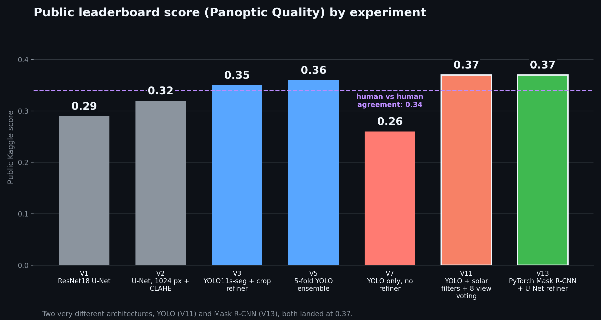
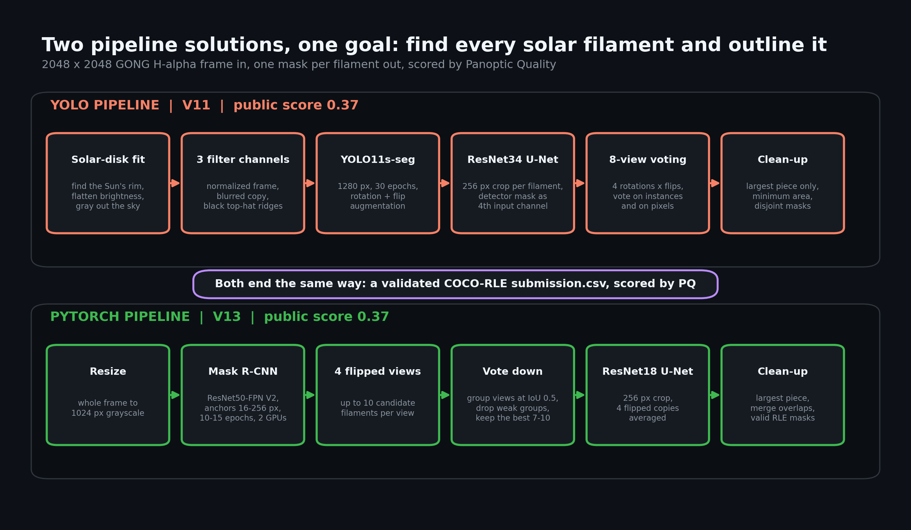

# **Computer Vision**

## Solar Filament Segmentation Challenge 2026

 
 

# **Computer Vision & Applied Machine Learning**

### YOLO Notebook Link

 
 
 
 

### PyTorch Notebook Link

 
 

## Teaching computer vision to find and outline the Sun's filaments

  

  <a href="TABLE_OF_CONTENTS.md"><b>Full table of contents</b></a>  ·  every notebook, report and evidence file

---

 

# **Two Pipeline Solutions, One Goal**
## **Scored Top 22%**
 
Pipeline final score: 0.36
 
Top score in competition: 0.54
 
(331/1468)
 

  

|                            | **YOLO V11**                                        | **PyTorch V13**                                 |
| -------------------------- | --------------------------------------------------------- | ----------------------------------------------------- |
| **Detector**         | YOLO11s-seg at 1280 px                                    | Mask R-CNN ResNet50-FPN V2 at 1024 px                 |
| **Crop refiner**     | ResNet34 U-Net, detector mask as 4th channel              | ResNet18 U-Net, 4 flipped copies averaged             |
| **Solar tricks**     | Sun's rim fitted, brightness flattened, 3 filter channels | Plain grayscale frame                                 |
| **Test-time voting** | 8 rotated and flipped views                               | 4 flipped views, up to 10 candidates each, voted down |
| **Public score**     | **0.37**                                            | **0.37**                                        |

 
 

## The task

What Are Solar Filaments?
Filaments (as shown below) are dense "clouds" of solar material suspended by magnetic field lines above photospheric neutral lines. The significance of filaments for space weather research lies in the fact that they are at the core of solar eruptions, including Coronal Mass Ejections (CMEs), solar flares, and Solar Energetic Particle (SEP) storms. An Earth-directed CME can cause enormous damage to the electric power grid, disrupt GPS systems, create radiation hazards for passengers and crew on polar flights, and be lethal to astronauts traveling outside the protective bubble provided by the Earth's magnetosphere. This is why solar filaments are a critical event type in space weather research and forecasting operations.

Solar filaments are thin, dark, irregular ribbons of cool gas floating above the Sun's surface. Finding them one by one in GONG H-alpha photographs matters for space-weather research, and it is hard: they are only about 8 to 11 pixels wide on a 2048 x 2048 frame, they curl, they touch, and even expert annotators disagree about where one ends and the next begins.

This project turns each grayscale solar photograph into **one clean mask per filament**: from scientific image ingestion and model training to measurable evaluation and validated competition submissions.

 
 

<table>
  <tr>
    <td align="center" width="33%">
      <h3>Input</h3>
      2048 x 2048 grayscale H-alpha observation
    </td>
    <td align="center" width="33%">
      <h3>Output</h3>
      One mask for every filament
    </td>
    <td align="center" width="33%">
      <h3>Score</h3>
      Panoptic Quality (PQ)
    </td>
  </tr>
</table>

 
 

## How the score works

Submissions are scored by **Panoptic Quality (PQ)**. A predicted mask counts as a match (a true positive, TP) when it
overlaps a human-drawn filament with an intersection over union (IoU) above 0.5. Unmatched predictions are false positives (FP) and unmatched human filaments are false negatives (FN):
 
 
 

$$
\mathrm{PQ} \;=\; \frac{\displaystyle\sum_{(p,\,g)\,\in\,\mathrm{TP}} \mathrm{IoU}(p,\,g)}{|\mathrm{TP}| \;+\; \tfrac{1}{2}\,|\mathrm{FP}| \;+\; \tfrac{1}{2}\,|\mathrm{FN}|}
$$

 
 
 

PQ rewards masks that are both found and well outlined, and every extra or missed filament lowers the score. This is the standard PQ definition; the leaderboard's exact implementation is not published.

## Results at a glance

  <table width="88%" cellpadding="12">
    <thead>
    <tr>
      <th>Experiment</th>
      <th>What changed</th>
      <th>Public PQ</th>
    </tr>
    </thead>
    <tbody>
    <tr>
      <td align="center">V1</td>
      <td>ResNet18 U-Net baseline, 512 px</td>
      <td align="center">0.29</td>
    </tr>
    <tr>
      <td align="center">V2</td>
      <td>Fine-tuned at 1024 px with CLAHE</td>
      <td align="center">0.32</td>
    </tr>
    <tr>
      <td align="center">V3</td>
      <td>YOLO11s-seg and a crop refiner</td>
      <td align="center">0.35</td>
    </tr>
    <tr>
      <td align="center">V5</td>
      <td>Five-fold YOLO ensemble</td>
      <td align="center">0.36</td>
    </tr>
    <tr>
      <td align="center">V7</td>
      <td>YOLO only, no refiner</td>
      <td align="center">0.26</td>
    </tr>
    <tr>
      <td align="center"><b>V11</b></td>
      <td><b>YOLO, solar filters, 8-view voting</b></td>
      <td align="center"><b>0.37</b></td>
    </tr>
    <tr>
      <td align="center"><b>V13</b></td>
      <td><b>PyTorch Mask R-CNN, flip voting</b></td>
      <td align="center"><b>0.37</b></td>
    </tr>
    </tbody>
  </table>

Scores are whole-pipeline comparisons, not controlled experiments. Every full notebook is listed in the
[table of contents](TABLE_OF_CONTENTS.md#notebooks-by-version).

## What we learned

- **Humans disagree too.** Two annotators labeling the same photo agree at a PQ of only **0.34** (measured across 296
  photos with two or more annotators). Both pipelines score close to that human-level agreement.
- ⏱ **More training did not help.** A partial run of a 100-epoch YOLO run converged near 0.40 mAP50-95 and the same public score band; the PyTorch pipeline scored 0.37 at both 10 and 15 epochs.
- **The Sun's disk is worth identifying.** Fitting the rim, graying out the sky and flattening brightness raised the
  per-pixel filament-versus-background separability (AUC) from about 0.78 to 0.83, and a black top-hat plus blur channel reached about 0.89.
- **Different models, same ceiling.** A YOLO pipeline and a Mask R-CNN pipeline, built very differently, landed on the
  same 0.37.

## Explore

|                                                                                                           |                                                      |
| --------------------------------------------------------------------------------------------------------- | ---------------------------------------------------- |
| [**Table of contents**](TABLE_OF_CONTENTS.md)                                                        | Every notebook, report, script and piece of evidence |
| [Solar Vision V13 notebook](<Kaggle%20Competition/Notebooks/solar_filament_CV_V13_maskrcnn_refiner.ipynb>) | PyTorch Mask R-CNN + U-Net refiner, 0.37             |
| [YOLO V11 notebook](<Kaggle%20Competition/Notebooks/solar_filament_CV_V11_crop_refined.ipynb>)             | YOLO11-seg + crop refiner + solar filters, 0.37      |
| [Competition page](https://www.kaggle.com/competitions/filament-segmentation-2026)                         | Rules, data and leaderboard on Kaggle                |

> The video shows baseline predictions beside human annotations. It includes training, tuning and holdout images, so it is a
> qualitative review, not an independent performance measurement.

## Credentials and licensing

Keep credentials in Kaggle Secrets or another secure credential store, never in notebooks. Obtain the competition data
through Kaggle. The [MIT license](LICENSE) covers original project code; third-party datasets, templates, software and
pretrained weights keep their own terms.

