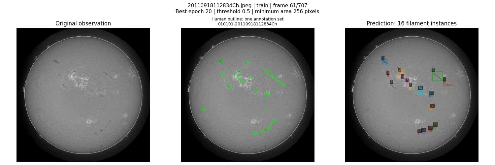
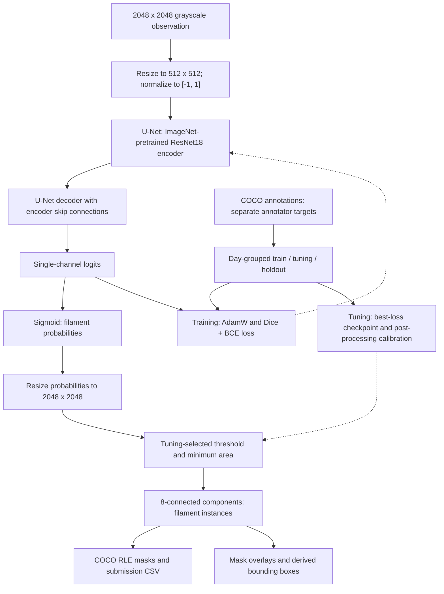

# **Solar Filament Segmentation Challenge 2026**

# Solar filament CV: train, evaluate, and export

## Gregory Kojadinovich II

# **Kaggle GPU pipeline:**

grayscale observations + COCO annotations -> day-grouped train/tuning/holdout -> pretrained U-Net -> threshold/area calibration -> individual masks -> full-resolution COCO RLE CSV.

An intensity/contrast CV baseline is evaluated on the same splits. 

Run on Kaggle with the competition data attached, a GPU accelerator, and Internet enabled for installation and pretrained weights. 

Default: 20 epochs; this is a starting configuration, not a demonstrated optimal model.

## Baseline video showcase

**[Watch or download the baseline filament review video](baselinevideo/download.mp4)**

*Actual frame at 00:30. Click the thumbnail to open the video.*

### CV architecture

Bounding boxes are visualization post-processing, not learned detection
outputs. The baseline uses a fixed grouped split, not K-fold evaluation.

The downloaded Kaggle video reviews 707 labeled observations frame by frame
at two frames per second (5 minutes 53.5 seconds). The review displays the
solar observation, a human annotation, and model-predicted filament masks
with bounding boxes. Boxes are derived from connected predicted regions;
they are not a separate learned object detector.

This sequence includes training, tuning, and holdout imagery, so it is a
qualitative review, not an independent test-set performance measurement.
It is the baseline review video, not the small locally trained demonstration.
If GitHub does not play the MP4 inline, use its download control to view it.

## Status

Work in progress for the [Kaggle competition](https://www.kaggle.com/competitions/filament-segmentation-2026).
Submission acceptance and leaderboard results are pending. This repository is
not yet a complete reproducibility package: final Kaggle weights, calibration,
and environment-pinned requirements must still be added.

## Contents

- [Submission-run notebook](RunningNotebook/solar-filament-cv.ipynb).
- [Development notebook](solar_filament_CV.ipynb), including optional experiments and video generation.
- [Data and research notebook](solar_filament_data_and_research.ipynb).
- [Computer vision tutorial](CV_TUTORIAL.md).
- [Academic draft](AcademicPaper/SolarFilament.tex) and [PDF preview](AcademicPaper/SolarFilament.pdf).

The baseline is a grayscale U-Net with a ResNet18 encoder, Dice/BCE loss,
and a fixed observation-day-grouped train/tuning/holdout split, not K-fold
cross-validation. Grouped K-fold, higher resolution, and CLAHE are proposed V2
experiments, not claimed baseline improvements.

## Running

Use the Kaggle notebook with the competition dataset attached and a GPU enabled.
Read its configuration before Run All. For submission, the final preparation
cell performs local checks and writes `/kaggle/working/submission.csv`;
it does not upload through the API. Save the completed notebook version and
select that CSV using Kaggle's Submit button. Zero-detection image handling
still requires confirmation of Kaggle acceptance.

To reproduce without training, obtain the matching final experiment's
`best_model.pt`, `calibration.json`, and split/provenance files, set
`CHECKPOINT_INPUT_DIR` to that experiment directory, and disable
`RUN_TRAINING` and `RUN_CALIBRATION`. Those final artifacts are not included yet.
Never use the small local demo's smoke-test weights for submission.

## Credentials and licensing

Use Kaggle Secrets for `HF_TOKEN`; never embed credentials in notebooks.
Local datasets, credentials, experiment outputs, and third-party reference
PDFs are excluded from Git. The MIT license covers original project code;
third-party datasets, templates, software, and pretrained weights retain
their own terms. Obtain competition data through Kaggle rather than this repository.

The academic PDF is a preliminary local preview with placeholders and a
minimal local preamble, not a verified final organizer-format submission.
