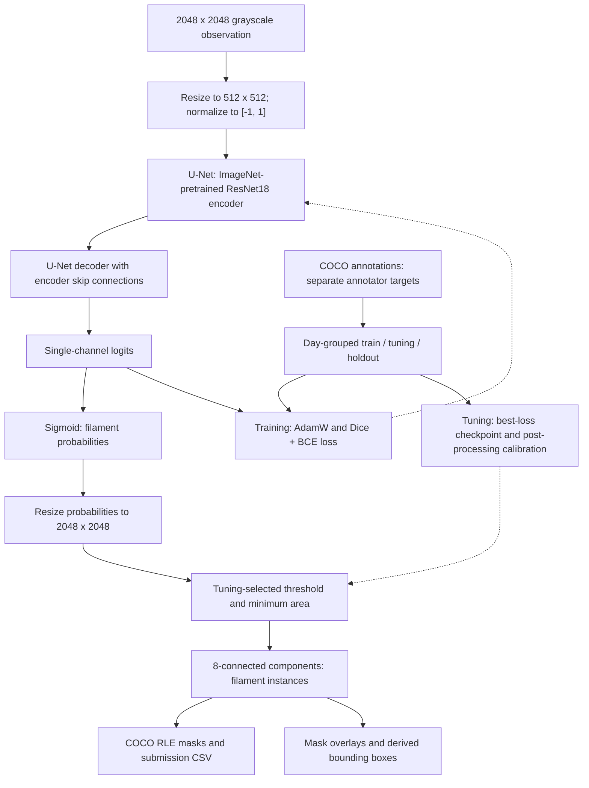

# Solar Filament Segmentation Challenge 2026

### Solar filament CV: train, evaluate, and export

**Europa Waters LLC | Computer Vision & Applied Machine Learning**  
**Gregory Kojadinovich II**

An applied computer vision research project exploring reproducible segmentation
of solar filaments in grayscale GONG H-alpha observations. The work brings
together supervised deep learning, classical image processing, grouped
evaluation, and visual model inspection in an end-to-end scientific workflow.

[Watch the demo](baselinevideo/preview-60s.mp4) ·
[Explore the baseline](RunningNotebook/solar-filament-cv.ipynb) ·
[Explore V2](solar_filament_CV_V2.ipynb) ·
[Read the paper draft](AcademicPaper/SolarFilament.pdf) ·
[Competition](https://www.kaggle.com/competitions/filament-segmentation-2026)

> **Research status:** Baseline and V2 pipeline implementations are available.
> Leaderboard results and full V2 comparisons remain pending. This showcase
> demonstrates the workflow, not a claim of benchmark superiority or production readiness.

## See the model at work

**[Open the 60-second video](baselinevideo/preview-60s.mp4)**  
*A real baseline inference review, presented as a continuously looping preview.
Click the preview to open the higher-quality MP4. GitHub scales the image to
the available page width.*

### CV architecture

Bounding boxes are visualization post-processing, not learned detection
outputs. The baseline uses a fixed grouped split, not K-fold evaluation.

## Engineering highlights

| Capability | Implementation |
|---|---|
| Scientific image ingestion | Grayscale observations and COCO filament annotations |
| Segmentation | Single-channel U-Net with a pretrained ResNet18 encoder |
| Leakage-aware evaluation | Observation-day grouping; annotator-specific targets kept together |
| Classical CV comparison | Intensity/contrast baseline evaluated on the same V1 partitions |
| Instance extraction | Full-resolution probabilities, connected components, and area filtering |
| Visual inspection | Mask overlays, component-derived boxes, and frame-by-frame video |
| Experiment traceability | Checkpoint hashes, split manifests, calibration, and saved metrics |
| V2 research | Higher resolution, CLAHE, grouped outer folds, and budgeted parameter search |

The V1 starting configuration is **20 epochs, batch size 8, learning rate
3e-4, and 512 × 512 input**. These are baseline settings, not established
optimal hyperparameters. Training runs on Kaggle with competition data,
a GPU accelerator, and Internet access for dependencies and pretrained weights.

### How to interpret the preview

This clip shows the first 60 seconds of the downloaded Kaggle video, whose
full sequence reviews 707 labeled observations at two frames per second.
The review displays the
solar observation, a human annotation, and model-predicted filament masks
with bounding boxes. Boxes are derived from connected predicted regions;
they are not a separate learned object detector.

This sequence includes training, tuning, and holdout imagery, so it is a
qualitative review, not an independent test-set performance measurement.
It is the baseline review video, not the small locally trained demonstration.
If GitHub does not play the MP4 inline, use its download control to view it.

## Status

Work in progress for the [Kaggle competition](https://www.kaggle.com/competitions/filament-segmentation-2026).
Submission acceptance and leaderboard results are pending. This repository is
not yet a complete reproducibility package: final Kaggle weights, calibration,
and environment-pinned requirements must still be added.

## Contents

- [Submission-run notebook](RunningNotebook/solar-filament-cv.ipynb).
- [Development notebook](solar_filament_CV.ipynb), including optional experiments and video generation.
- [V2 nested grouped experiment](solar_filament_CV_V2.ipynb): three outer day-grouped folds, inner holdout tuning, higher-resolution/CLAHE ablations, and bounded hyperparameter search.
- [Data and research notebook](solar_filament_data_and_research.ipynb).
- [Computer vision tutorial](CV_TUTORIAL.md).
- [Academic draft](AcademicPaper/SolarFilament.tex) and [PDF preview](AcademicPaper/SolarFilament.pdf).

The baseline is a grayscale U-Net with a ResNet18 encoder, Dice/BCE loss,
and a fixed observation-day-grouped train/tuning/holdout split, not K-fold
cross-validation. Grouped K-fold, higher resolution, and CLAHE are implemented
as separate V2 experiments, not measured improvements to the submitted baseline.

## V2 experiment

Open [the self-contained V2 notebook](solar_filament_CV_V2.ipynb) on Kaggle with
the competition data, Internet, and a GPU enabled. V1's active run is not modified.
The [V2 dependency manifest](requirements-v2.txt) gives supported minimum ranges;
the notebook records the actual installed versions in its experiment output.

- Three outer folds grouped by observation day; a separate inner validation
  holdout controls checkpoints, calibration, and candidate selection.
- Four controls: 512/raw, 512/CLAHE, 1024/raw, and 1024/CLAHE, plus two seeded
  random candidates sampling learning rate, weight decay, batch size, and
  CLAHE clip limit. This is bounded optimization, not a global optimum.
- Up to 60 epochs, inner-loss early stopping, and learning-rate reduction on a plateau.
- Default **two-hour wall allowance** for nested training and scoring.
  Eighteen trials will likely be budget-truncated; a two-hour limit cannot
  guarantee convergence or a complete comparison. Checks are cooperative;
  installation, downloads, single operations, and optional export add overhead.
- Increase `V2["hours"]` and choose a new `run_name` for longer training.
  Reusing an unchanged plan skips finished trials but does not extend their training.
- Full three-fold mean/sample-SD results require all folds to finish. Incomplete
  runs and truncated trials are labeled explicitly. Outer metrics must not be
  reused to select a candidate after seeing them.

Optional fold-ensemble test export is off by default and requires complete
non-smoke results. It does not submit through the API. All V2 numerical
results and leaderboard comparisons remain pending; only tiny real-data
pipeline tests have been run locally, not full high-resolution training.

## Running

Use the Kaggle notebook with the competition dataset attached and a GPU enabled.
Read its configuration before Run All. For submission, the final preparation
cell performs local checks and writes `/kaggle/working/submission.csv`;
it does not upload through the API. Save the completed notebook version and
select that CSV using Kaggle's Submit button. Zero-detection image handling
still requires confirmation of Kaggle acceptance.

To reproduce without training, obtain the matching final experiment's
`best_model.pt`, `calibration.json`, and split/provenance files, set
`CHECKPOINT_INPUT_DIR` to that experiment directory, and disable
`RUN_TRAINING` and `RUN_CALIBRATION`. Those final artifacts are not included yet.
Never use the small local demo's smoke-test weights for submission.

## Credentials and licensing

Use Kaggle Secrets for `HF_TOKEN`; never embed credentials in notebooks.
Local datasets, credentials, experiment outputs, and third-party reference
PDFs are excluded from Git. The MIT license covers original project code;
third-party datasets, templates, software, and pretrained weights retain
their own terms. Obtain competition data through Kaggle rather than this repository.

The academic PDF is a preliminary local preview with placeholders and a
minimal local preamble, not a verified final organizer-format submission.
