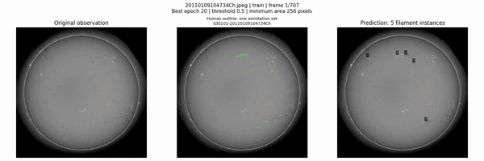
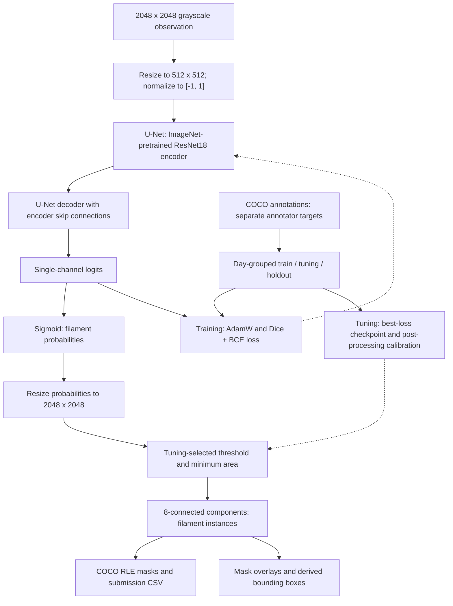

# Solar Filament Segmentation Challenge 2026

### Solar filament CV: train, evaluate, and export

**Europa Waters LLC | Computer Vision & Applied Machine Learning**  
**Gregory Kojadinovich II**

An applied computer vision research project exploring reproducible segmentation
of solar filaments in grayscale GONG H-alpha observations. The work brings
together supervised deep learning, classical image processing, grouped
evaluation, and visual model inspection in an end-to-end scientific workflow.

[Watch the demo](baselinevideo/preview-60s.mp4) ·
[Explore the baseline](RunningNotebook/solar-filament-cv.ipynb) ·
[Explore V2](solar_filament_CV_V2.ipynb) ·
[Explore V3](solar_filament_CV_V3.ipynb) ·
[Read the paper draft](AcademicPaper/SolarFilament.pdf) ·
[Competition](https://www.kaggle.com/competitions/filament-segmentation-2026)

> **Research status:** Baseline and V2 pipeline implementations are available.
> V1 achieved **0.29 public Kaggle PQ** (submission 58301531, verified complete).
> Focused V2 achieved **0.32 public PQ** (submission 58304132, verified complete).
> Repaired V3 achieved **0.35 public PQ** (submission 58316663, verified complete).
> Grouped-fold comparisons remain pending. This showcase
> demonstrates the workflow, not a claim of benchmark superiority or production readiness.

## See the model at work

<a href="baselinevideo/preview-60s.mp4">
  
</a>

**[Open the 60-second video](baselinevideo/preview-60s.mp4)**  
*A real baseline inference review, presented as a continuously looping preview.
Click the preview to open the higher-quality MP4. GitHub scales the image to
the available page width.*

### CV architecture



Bounding boxes are visualization post-processing, not learned detection
outputs. The baseline uses a fixed grouped split, not K-fold evaluation.

## Engineering highlights

| Capability | Implementation |
|---|---|
| Scientific image ingestion | Grayscale observations and COCO filament annotations |
| Segmentation | Single-channel U-Net with a pretrained ResNet18 encoder |
| Leakage-aware evaluation | Observation-day grouping; annotator-specific targets kept together |
| Classical CV comparison | Intensity/contrast baseline evaluated on the same V1 partitions |
| Instance extraction | Full-resolution probabilities, connected components, and area filtering |
| Visual inspection | Mask overlays, component-derived boxes, and frame-by-frame video |
| Experiment traceability | Checkpoint hashes, split manifests, calibration, and saved metrics |
| V2 research | Higher resolution, CLAHE, grouped outer folds, and budgeted parameter search |
| V3 research | YOLO11s instance proposals, U-Net crop refinement, and image/math EDA |

The V1 starting configuration is **20 epochs, batch size 8, learning rate
3e-4, and 512 × 512 input**. These are baseline settings, not established
optimal hyperparameters. Training runs on Kaggle with competition data,
a GPU accelerator, and Internet access for dependencies and pretrained weights.

### How to interpret the preview

This clip shows the first 60 seconds of the downloaded Kaggle video, whose
full sequence reviews 707 labeled observations at two frames per second.
The review displays the
solar observation, a human annotation, and model-predicted filament masks
with bounding boxes. Boxes are derived from connected predicted regions;
they are not a separate learned object detector.

This sequence includes training, tuning, and holdout imagery, so it is a
qualitative review, not an independent test-set performance measurement.
It is the baseline review video, not the small locally trained demonstration.
If GitHub does not play the MP4 inline, use its download control to view it.

## Status

Work in progress for the [Kaggle competition](https://www.kaggle.com/competitions/filament-segmentation-2026).
V1 submission 58301531 completed with a public score of **0.29**, verified through
the Kaggle API on November 13, 2026. Its three zero-detection image omissions
were accepted in this submission. This repository is
not yet a complete reproducibility package: final Kaggle weights, calibration,
and environment-pinned requirements must still be added.

## Contents

- [Submission-run notebook](RunningNotebook/solar-filament-cv.ipynb).
- [Development notebook](solar_filament_CV.ipynb), including optional experiments and video generation.
- [V2 nested grouped experiment](solar_filament_CV_V2.ipynb): three outer day-grouped folds, inner holdout tuning, higher-resolution/CLAHE ablations, and bounded hyperparameter search.
- [V3 instance-segmentation notebook](solar_filament_CV_V3.ipynb): YOLO11s, crop refinement, and training-image EDA.
- [Data and research notebook](solar_filament_data_and_research.ipynb).
- [Computer vision tutorial](CV_TUTORIAL.md).
- [Academic draft](AcademicPaper/SolarFilament.tex) and [PDF preview](AcademicPaper/SolarFilament.pdf).

The baseline is a grayscale U-Net with a ResNet18 encoder, Dice/BCE loss,
and a fixed observation-day-grouped train/tuning/holdout split, not K-fold
cross-validation. Grouped K-fold, higher resolution, and CLAHE are implemented
as separate V2 experiments, not measured improvements to the submitted baseline.

## V2 experiment

### Focused fine-tuning run

[Focused V2 notebook](solar_filament_CV_V2_focused.ipynb) starts from the exact V1
checkpoint, retaining its day-grouped split. It tests 1024px + CLAHE, batch two,
a fresh AdamW optimizer at 1e-4, plateau learning-rate reduction, and up to
40 additional epochs with early stopping. Its cooperative two-hour budget
reserves ten minutes for calibration and test export. Epoch zero can remain
the best checkpoint if training does not improve tuning loss.

The [separate Kaggle run](https://www.kaggle.com/code/gregkoja/solar-filament-cv-v2-focused)
completed; submission 58304132 achieved **0.32 public PQ**, a **0.03 absolute
increase** over V1. Changing several settings together is an exploratory
experiment, not a controlled attribution of improvements to any single factor.

### Grouped-fold research notebook

Open [the self-contained V2 notebook](solar_filament_CV_V2.ipynb) on Kaggle with
the competition data, Internet, and a GPU enabled. V1's active run is not modified.
The [V2 dependency manifest](requirements-v2.txt) gives supported minimum ranges;
the notebook records the actual installed versions in its experiment output.

- Three outer folds grouped by observation day; a separate inner validation
  holdout controls checkpoints, calibration, and candidate selection.
- Four controls: 512/raw, 512/CLAHE, 1024/raw, and 1024/CLAHE, plus two seeded
  random candidates sampling learning rate, weight decay, batch size, and
  CLAHE clip limit. This is bounded optimization, not a global optimum.
- Up to 60 epochs, inner-loss early stopping, and learning-rate reduction on a plateau.
- Default **two-hour wall allowance** for nested training and scoring.
  Eighteen trials will likely be budget-truncated; a two-hour limit cannot
  guarantee convergence or a complete comparison. Checks are cooperative;
  installation, downloads, single operations, and optional export add overhead.
- Increase `V2["hours"]` and choose a new `run_name` for longer training.
  Reusing an unchanged plan skips finished trials but does not extend their training.
- Full three-fold mean/sample-SD results require all folds to finish. Incomplete
  runs and truncated trials are labeled explicitly. Outer metrics must not be
  reused to select a candidate after seeing them.

Optional grouped-fold ensemble test export is off by default and requires complete
non-smoke results. It does not submit through the API. V2
grouped-fold results remain pending; only tiny real-data
pipeline tests have been run locally, not full high-resolution training.

## V3: instance segmentation and crop refinement

Read the [V1/V2/V3 mask EDA and V4 recommendations](reports/V1_V2_V3_MASK_EDA_V4.md)
for all-180-image measurements, instance overlays, disagreement close-ups,
training curves, and reproducible analysis. Test-output differences are
descriptive, not per-image ground-truth accuracy.

[V3 notebook](solar_filament_CV_V3.ipynb) implements YOLO11s segmentation
followed by a ResNet18/U-Net crop refiner. It compares **YOLO-only vs refined
masks on the same tuning images** and exports the tuning-selected mode.
The disjoint-mask-repaired V3 submission achieved **0.35 public PQ**:
**+0.03 absolute over focused V2** and **+0.06 over V1**.
This result is not a controlled attribution to architecture alone and does not reproduce
the supplied reference notebook's reported ~0.69 score.

- 1024px detector input, up to 60 epochs, patience eight, 75-minute
  detector training allowance.
- 256px context crops, up to 20 refiner epochs, patience five,
  30-minute refiner allowance; setup, scoring, and export add overhead.
- Fixed observation-day split, with separate annotator training targets;
  V3 is not K-fold. The grouped V2 study remains separate.
- Training-image EDA: intensities, edge maps, resolution sampling, instance
  areas, box geometry, and annotated crop transforms.
- LaTeX-rendered math: normalization, sigmoid, Dice/BCE, IoU, and instance PQ;
  tuning-image error overlays and pairwise instance-IoU heatmaps.
- Full-resolution COCO masks, readback/hash validation, and audited
  zero-detection or empty-refinement outcomes. Disjoint masks are enforced
  during tuning and export, with a final zero-overlap validation.

The crop refiner cannot recover instances missed by YOLO. Similar crops can
produce overlapping masks. The `first-mask-wins-v1` policy retains proposal
order, removes pixels already owned by an earlier mask, and drops empty or
below-minimum-area remnants. Improved PQ is a hypothesis, not guaranteed.
Ultralytics' licensing is separate from this repository's original MIT code;
review [AGPL/enterprise terms](https://www.ultralytics.com/license) before
commercial deployment or redistribution.

### Run V3 yourself

From the repository root, with your Kaggle credentials configured:

```bash
cp solar_filament_CV_V3.ipynb kaggle-v3/
kaggle kernels push -p kaggle-v3
kaggle kernels status gregkoja/solar-filament-cv-v3
```

Or upload the canonical V3 notebook directly into Kaggle, enable GPU and
Internet, attach the competition, and Run All. Do not launch both workflows.
After successful completion, download the outputs:

```bash
kaggle kernels output gregkoja/solar-filament-cv-v3 -p cv_outputs/kaggle_v3
```

Review `CSV PREPARED` and select the completed V3 output CSV using Kaggle's
Submit button. Alternatively, after verifying the downloaded root CSV:

```bash
kaggle competitions submit -c filament-segmentation-2026 \
  -f cv_outputs/kaggle_v3/submission.csv -m "V3: YOLO11s and crop-refiner comparison"
```

V3 Kaggle version 1 was launched through the API with explicit user
authorization on November 13, 2026. Its initial submission was rejected for
overlapping masks (submission 58315901). The repaired CSV was submitted with
explicit user authorization as submission 58316663 and completed with **0.35
public PQ**. The pre-repair tuning metrics do not measure the repaired masks.
Further competition submissions remain user-controlled; do not launch a
duplicate training run to repair the CSV.

### Repair the original V3 output without retraining

The original exporter validated each RLE separately but did not check overlap
between instances. The repaired CSV preserves row order and IDs, removes
contested pixels from later masks, and validates all image masks together.
It does not invent detections for omitted images. This is a validity repair,
not a measured score improvement or a new training run.

With the V3 dependencies installed, download the existing output and repair it:

```bash
kaggle kernels output gregkoja/solar-filament-cv-v3 -p cv_outputs/kaggle_v3
python submission_masks.py \
  cv_outputs/kaggle_v3/submission.csv \
  cv_outputs/kaggle_v3/submission_disjoint.csv \
  --test-dir data/MAGFiLO_1.0_Kaggle_2026/test --min-area 20
```

The command preserves the original and writes a matching `.audit.json` with
source/output hashes, affected images, removed overlap pixels, dropped IDs,
and zero-detection images. Existing output paths are not overwritten.
Manually submit **`submission_disjoint.csv`**, not the original CSV.
No upload is performed by the repair command.

For future V3 exports, disjoint postprocessing is also applied during tuning.
Existing weights do not need retraining: set `RUN_YOLO_TRAINING=False` and
`RUN_REFINER_TRAINING=False`, keep `RUN_V3_CALIBRATION=True`, and use the same
saved experiment directory. Old calibration is rejected because its scores
were measured before disjoint postprocessing. Offline CSV repair does not
recalibrate; those old tuning scores must not be attributed to the repaired CSV.

Regression checks (no model training):

```bash
python -m unittest discover -s tests -p 'test_submission_masks.py'
```

## V4: longer training with explicit AdamW

See [V4 changes, rationale, and possible improvements](reports/V4_CHANGES_AND_NEXT_STEPS.md)
for the exact configuration comparison, optimizer choice, mask-validity policy,
and a prioritized evaluation plan.

The [V4 notebook](solar_filament_CV_V4.ipynb) retains V3's model family,
day-grouped split, input sizes, augmentations, and calibration grid. Changes:

- Detector: up to **120 epochs**, patience **15**, `time=None`.
- Refiner: up to **40 epochs**, patience **8**, no custom wall-time deadline.
- Detector AdamW is explicit: initial LR **0.002**, momentum **0.9**,
  weight decay **0.0005**, bias warmup LR **0**. These match V3's automatically
  selected optimizer settings; `auto` may select another optimizer for longer
  schedules, so it is intentionally disabled here.
- Refiner AdamW remains at **3e-4**, weight decay **1e-4**; its cosine schedule
  now spans 40 epochs.
- Ultralytics is pinned to **8.4.211**, as recorded for the V3 run.
- Both modes are calibrated with disjoint masks and independently validated
  before CSV export. No automatic competition upload.

This is a new run from pretrained YOLO/ImageNet initializations, not an
optimizer-state resume from V3. It uses a separate output directory. Longer
training does not guarantee improvement; early stopping and Kaggle platform
limits still apply. At V3's throughput, ceilings could take roughly **7-9
hours** end to end; this is an estimate, not a deadline.

Use the [V4 Kaggle metadata](kaggle-v4/kernel-metadata.json) only when a new
run is intended; do not launch a duplicate of an active run:

```bash
cp solar_filament_CV_V4.ipynb kaggle-v4/
kaggle kernels push -p kaggle-v4
kaggle kernels status gregkoja/solar-filament-cv-v4-longer-training
kaggle kernels output gregkoja/solar-filament-cv-v4-longer-training -p cv_outputs/kaggle_v4
```

No V4 leaderboard score is available. Review completed logs, calibration,
audit, and `CSV PREPARED` before deciding whether to submit.
Version 1 was launched with explicit user authorization on November 13, 2026:
[V4 Kaggle run](https://www.kaggle.com/code/gregkoja/solar-filament-cv-v4-longer-training).
No competition submission was performed by this launch.

## V5: fast five-fold YOLO + ResNet34 refiner and submission CSV

The separate [five-fold grouped notebook](solar_filament_CV_V5_grouped.ipynb)
is **updated but not launched**. It leaves the active V4 run unchanged.
Read the [current V5 settings and submission instructions](reports/V5_FAST_FIVE_FOLD_SUBMISSION.md)
before running it.

- Five observation-day outer folds; inner tuning is reserved separately.
- Approximately 72% training / 8% inner tuning / 20% outer evaluation.
- 508–512 unique training images per model; annotator targets stay grouped.
- All five folds selected by default: **5 detector epochs and 2 ResNet34 refiner
  epochs per fold** (25 detector / 10 refiner total).
- Two-hour total target with cooperative training budgets and a 20-minute
  final export reserve; slow operations may exceed the target or truncate epochs.
- All-five-fold mean/sample SD and pooled out-of-fold mean only after completion.
- Validated disjoint-mask **submission.csv** using **all five models** after
  all folds complete: one-to-one instance matching and equal-fold 3-of-5 pixel
  voting, with no outer-score weighting. Five-model inference adds export time;
  the two-hour target has not been measured.
- No automatic competition upload.

## Running

Use the Kaggle notebook with the competition dataset attached and a GPU enabled.
Read its configuration before Run All. For submission, the final preparation
cell performs local checks and writes `/kaggle/working/submission.csv`;
it does not upload through the API. Save the completed notebook version and
select that CSV using Kaggle's Submit button. Zero-detection image handling
still requires confirmation of Kaggle acceptance.

To reproduce without training, obtain the matching final experiment's
`best_model.pt`, `calibration.json`, and split/provenance files, set
`CHECKPOINT_INPUT_DIR` to that experiment directory, and disable
`RUN_TRAINING` and `RUN_CALIBRATION`. Those final artifacts are not included yet.
Never use the small local demo's smoke-test weights for submission.

## Credentials and licensing

Use Kaggle Secrets for `HF_TOKEN`; never embed credentials in notebooks.
Local datasets, credentials, experiment outputs, and third-party reference
PDFs are excluded from Git. The MIT license covers original project code;
third-party datasets, templates, software, and pretrained weights retain
their own terms. Obtain competition data through Kaggle rather than this repository.

The academic PDF is a preliminary local preview with placeholders and a
minimal local preamble, not a verified final organizer-format submission.
