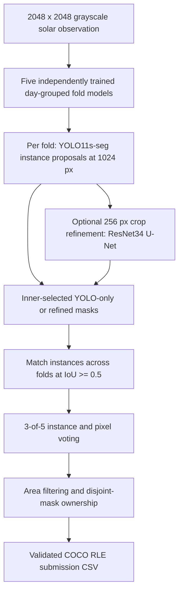

# Solar Filament Segmentation Challenge 2026

<a href="Research/Baseline%20Video/preview-60s.mp4">
  
</a>

**[Watch the 60-second baseline review](Research/Baseline%20Video/preview-60s.mp4)**

The video shows baseline predictions alongside human annotations. It includes
training, tuning, and holdout images, so it is a qualitative review—not an
independent performance measurement. Boxes are derived from predicted masks.

## Computer vision for a dynamic Sun

Solar filaments are thin, irregular structures that can be difficult to identify
and separate in solar images. This project applies computer vision to turn
grayscale GONG H-alpha observations into individual filament masks: from
scientific image ingestion and model training to measurable evaluation and
validated competition submissions.

**Computer Vision & Applied Machine Learning**

[Technical report](Research/Academic%20Paper/SolarFilament_V4.pdf) ·
[V5 notebook](Kaggle%20Competition/Notebooks/solar_filament_CV_V5_grouped.ipynb) ·
[V5 evidence](Kaggle%20Competition/reports/V5_FAST_FIVE_FOLD_SUBMISSION.md) ·
[Competition](https://www.kaggle.com/competitions/filament-segmentation-2026)

## Results

| Experiment  | Technical change                                    | Public Kaggle PQ | Submission |
| ----------- | --------------------------------------------------- | ---------------: | ---------: |
| V1          | ResNet18 U-Net baseline, 512 px                     |   **0.29** |   58301531 |
| Focused V2  | V1 fine-tuning, 1024 px and CLAHE                   |   **0.32** |   58304132 |
| Repaired V3 | YOLO11s-seg, ResNet18 crop refiner                  |   **0.35** |   58316663 |
| V5          | Five day-grouped YOLO11s-seg / ResNet34 U-Net pairs |   **0.36** |   58327117 |
| V7          | Five-fold YOLO11s-seg, no crop refiner, up to 10 epochs/fold | **0.26** | 58336694 |

V5 is the best verified public result so far: **+0.07 absolute PQ** over V1.
These are exploratory whole-pipeline comparisons, not controlled evidence that
any single change caused the gain. V4 has no reported competition score and V6
is unscored. V7 completed with 0.26 PQ, 0.10 below V5. This favors investigating
crop refinement, but does not isolate its effect from the other changed settings.
The V4 academic report is a document version, not the V4 model experiment.

## Best-scoring architecture: V5



Each fold trains a detector and refiner; inner tuning selects which output to
use. All five models contribute to fusion, which has no separately trained
parameters. The public score evaluates this complete pipeline, not the
refiner alone. See the [V5 protocol](Kaggle%20Competition/reports/V5_FAST_FIVE_FOLD_SUBMISSION.md).

## Technical observations

- **Input:** 2048 × 2048 grayscale H-alpha intensity images, not magnetograms.
  The task segments filament instances; it does not infer chirality or magnetic
  polarity.
- **Evaluation:** observation-day grouping keeps photographs and their
  annotator-specific targets together. Inner tuning selects model settings;
  outer holdouts evaluate the selected fold models. Fold metrics are not a
  five-model ensemble score.
- **Instance quality:** YOLO proposes separate objects; optional U-Net
  refinement adjusts local masks. The ensemble matches instances across folds
  and votes on foreground pixels.
- **Submission integrity:** masks are made disjoint and checked for valid RLE,
  dimensions, IDs, CSV readback, and overlaps. The accepted
  [V5 CSV](Kaggle%20Competition/V5_SubmissionFile/submission.csv) contains 1,127 masks across
  177 images; its [audit and provenance](Kaggle%20Competition/reports/V5_FAST_FIVE_FOLD_SUBMISSION.md)
  describe the three images without retained predictions.
- **Limitations:** the labeled data have been used during development, public
  scores are not causal ablations, and final V1/V3/V5 weights, calibration,
  logs, and pinned environments still need to be published for complete
  reproduction. The scored V5 run exceeded its original two-hour target.

## Explore the work

| Resource                                                                                                                     | Purpose                                                                                         |
| ---------------------------------------------------------------------------------------------------------------------------- | ----------------------------------------------------------------------------------------------- |
| [V4 final report PDF](Research/Academic%20Paper/SolarFilament_V4.pdf) · [LaTeX source](Research/Academic%20Paper/SolarFilament_V4.tex) | Final draft including the verified V7 result and crop-refinement discussion. |
| [V3 technical report PDF](Research/Academic%20Paper/SolarFilament_V3.pdf) · [LaTeX source](Research/Academic%20Paper/SolarFilament_V3.tex) | Previous draft; results through V5, preserved. |
| [V2 report PDF](Research/Academic%20Paper/SolarFilament_V2.pdf) · [source](Research/Academic%20Paper/SolarFilament_V2.tex) | Previous visual report draft, retained for comparison. |
| [Results review](Research/Academic%20Paper/RESULTS_REVIEW.md) | Loss histories, labeled V1 metrics, and prediction agreement across four runs. |
| [First-draft PDF](Research/Academic%20Paper/SolarFilament.pdf) · [source](Research/Academic%20Paper/SolarFilament.tex) | Historical report, retained for comparison. |
| [Baseline notebook](Kaggle%20Competition/Notebooks/solar-filament-cv.ipynb) | ResNet18 U-Net shown in the video. |
| [Focused V2 notebook](Kaggle%20Competition/Notebooks/solar_filament_CV_V2_focused.ipynb) · [saved evidence](Kaggle%20Competition/V2Output/results/v2_focused_1024_clahe_from_v1/) | Scored higher-resolution fine-tuning experiment. |
| [V3 notebook](Kaggle%20Competition/Notebooks/solar_filament_CV_V3.ipynb) · [mask analysis](Kaggle%20Competition/reports/V1_V2_V3_MASK_EDA_V4.md) | Instance proposals, crop refinement, and failure analysis. |
| [V5 notebook](Kaggle%20Competition/Notebooks/solar_filament_CV_V5_grouped.ipynb) · [protocol](Kaggle%20Competition/reports/V5_FAST_FIVE_FOLD_SUBMISSION.md) | Best verified five-fold ensemble and submission provenance. |
| [V6 notebook](Kaggle%20Competition/Notebooks/solar_filament_CV_V6_grouped.ipynb) · [V7 notebook](Kaggle%20Competition/Notebooks/solar_filament_CV_V7_yolo_only.ipynb) | Unscored V6 and scored YOLO-only V7 (0.26 PQ). |
| [Research notebook](Research/Notes/solar_filament_data_and_research.ipynb) · [CV tutorial](Research/Notes/CV_TUTORIAL.md) · [tests](Kaggle%20Competition/pythontests/) | Exploration, educational material, and regression checks. |

The [notebooks](Kaggle%20Competition/Notebooks/) are the canonical implementations.
The [kaggle-v3](Kaggle%20Competition/kaggle-v3/) and
[kaggle-v4](Kaggle%20Competition/kaggle-v4/) directories are API upload staging.
[Shared CV orchestration](Kaggle%20Competition/Python%20Files/grouped_yolo_cv.py),
[mask validation](Kaggle%20Competition/Python%20Files/submission_masks.py), and
the [V7 runtime](Kaggle%20Competition/Python%20Files/v7_yolo_runtime.py)
support the standalone notebooks.

## Run and reproduce

Attach the competition dataset to a Kaggle notebook, enable Internet and a GPU,
and review the selected notebook's configuration before running. Download
outputs and inspect their plan, checkpoint hashes, calibration, and submission
audit; a notebook title alone does not establish which model produced a CSV.

**V5:** Follow the [five-fold protocol](Kaggle%20Competition/reports/V5_FAST_FIVE_FOLD_SUBMISSION.md).
All five completed folds are required for export. The notebook prepares a
validated CSV but does not automatically upload it.

**V7:** The [YOLO-only notebook](Kaggle%20Competition/Notebooks/solar_filament_CV_V7_yolo_only.ipynb) uses
five day-grouped folds, up to 10 epochs per fold, no wall-clock training limit,
and no crop refiner. It targets Kaggle T4x2 with training batch 10 total;
inference uses GPU 0 with batch 8. After five complete folds, it validates and
submits the CSV automatically. Add Kaggle Notebook Secrets named
`KAGGLE_USERNAME` and `KAGGLE_KEY` before running the submission cell. A local
validation pass does not guarantee Kaggle acceptance or a higher score.

**V3 repair:** The original V3 CSV had overlapping masks. The accepted repaired
submission removes overlap without retraining:

```bash
mkdir -p "Kaggle Competition/cv_outputs/v3_repair"
kaggle kernels output gregkoja/solar-filament-cv-v3 -p "Kaggle Competition/cv_outputs/v3_repair"
python "Kaggle Competition/Python Files/submission_masks.py" \
  "Kaggle Competition/cv_outputs/v3_repair/submission.csv" \
  "Kaggle Competition/cv_outputs/v3_repair/submission_disjoint.csv" \
  --test-dir "Kaggle Competition/data/MAGFiLO_1.0_Kaggle_2026/test" --min-area 20
```

The repair writes a separate CSV and audit; submit the repaired file, not the
original. It does not recalibrate the model or upload a submission.

**Rebuild the reports and run checks** from the repository root in an
environment with the plotting and notebook dependencies:

```bash
python -m pip install -r "Research/Academic Paper/requirements-figures.txt"
python "Research/Academic Paper/plot_paper_v2.py"
python "Research/Academic Paper/plot_pipeline_architectures.py"
tectonic -X compile "Research/Academic Paper/SolarFilament_V2.tex" --outdir "Research/Academic Paper"
tectonic -X compile "Research/Academic Paper/SolarFilament_V3.tex" --outdir "Research/Academic Paper"
tectonic -X compile "Research/Academic Paper/SolarFilament_V4.tex" --outdir "Research/Academic Paper"
PYTHONPATH="Kaggle Competition/Python Files" python -m unittest discover -s "Kaggle Competition/pythontests" -p 'test_*.py'
```

Additional model dependencies are listed in [Requirements/](Requirements/).

## Document control and submission

The current [V4 report](Research/Academic%20Paper/SolarFilament_V4.pdf) is the final
draft including verified V7 submission 58336694 (0.26 PQ). Earlier paper drafts
are retained. Preserve the reviewed PDF, repository revision, submission IDs,
scores, and supporting artifacts. Local edits are not public until committed
and pushed.

The competition prediction submission does not replace the organizers' judging
form and report upload. Check the form's current requirements and deadline.

## Credentials and licensing

Keep credentials in Kaggle Secrets or another secure credential store—never
embed them in notebooks. Obtain competition data through Kaggle. The
[MIT license](LICENSE) covers original project code; third-party datasets,
templates, software, and pretrained weights retain their own terms.

For CV/ML engineering or software collaboration, visit
[Gregory&#39;s GitHub profile](https://github.com/Greg-Kojadinovich).
