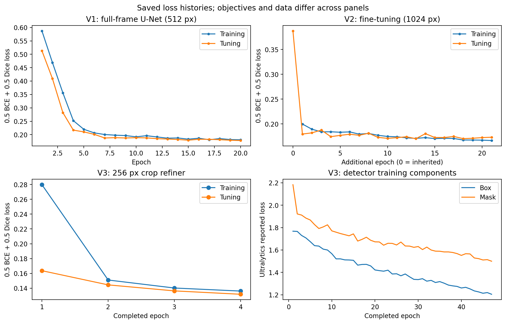
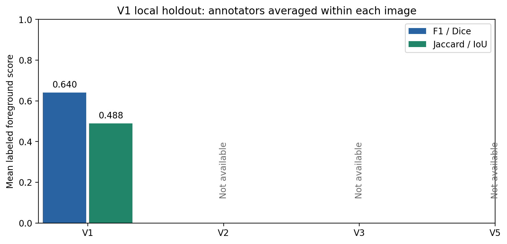
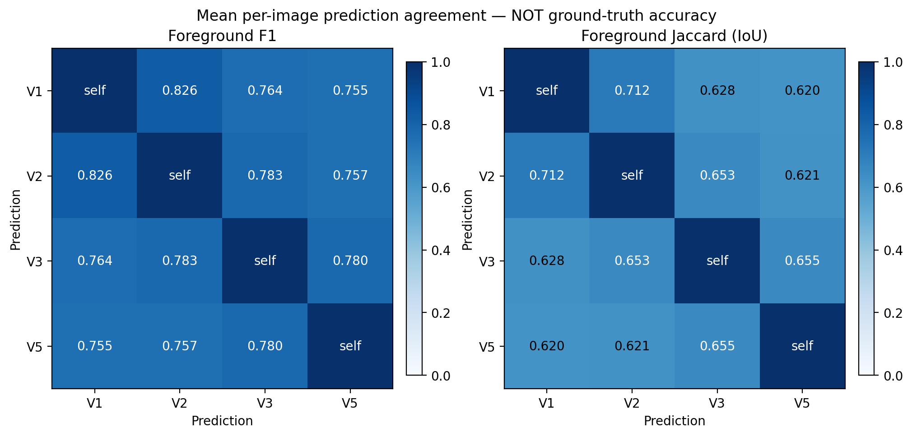
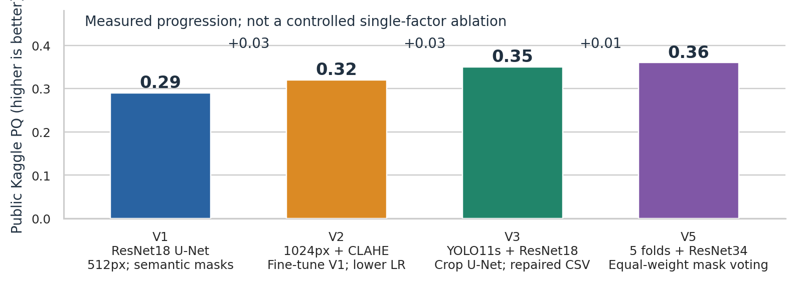

# Results review: V1, V2, V3, and V5

This supplement reviews the four scored pipelines in the V3 technical report.
It separates training diagnostics, labeled holdout results, public competition
scores, and agreement between predictions. These experiments changed several
settings at once and are not controlled ablations.

## Loss versus epoch



[PDF](results-review/loss_by_epoch.pdf) · [Editable SVG](results-review/loss_by_epoch.svg)

| Run | Available loss history | Observation |
|---|---|---|
| V1 | 20 full-frame U-Net epochs | Lowest tuning loss: 0.1781 at epoch 20. |
| V2 | 21 additional full-frame epochs | Lowest tuning loss: 0.1702 at additional epoch 13; epoch 0 is the inherited model before fine-tuning. |
| V3 | 47 complete detector epochs and four crop-refiner epochs | Refiner tuning loss falls from 0.1636 to 0.1318; training stopped on budget, not demonstrated convergence. A partial detector epoch 48 is omitted. |
| V5 | No scored-run epoch histories available | No curve or convergence claim can be verified. |

V1, V2, and the V3 refiner use equal-weight BCE and Dice loss, but use different
inputs, image resolutions, and training settings. The refiner uses crops, not
full-frame images. The detector plots its reported box and mask components,
which are different objectives. **Loss magnitudes are not a ranking of the
four complete pipelines** and are not competition PQ.

## Labeled F1 and Jaccard



[PDF](results-review/labeled_holdout.pdf) · [Editable SVG](results-review/labeled_holdout.svg)

The saved V1 local holdout summary reports foreground Dice/F1 **0.6405** and
Jaccard/IoU **0.4885** on 105 physical images and 166 annotator sets. It first
averages annotators within each image, then averages images; both-empty masks
are scored as 1. These values come from the original notebook's evaluation,
not a new scikit-learn calculation. They are local development evidence, not
a previously untouched final benchmark.

Comparable labeled predictions or saved labeled F1/IoU for the scored V2, V3,
and V5 runs were not available in the reviewed artifacts. Test labels are
private, so public test F1 and IoU cannot be calculated from the submission
CSVs. In particular, applying all five V5 models to the fold holdouts would
include models trained on those images; it would not be an unbiased ensemble
evaluation.

## F1 and Jaccard agreement between test predictions



[PDF](results-review/prediction_agreement.pdf) · [Editable SVG](results-review/prediction_agreement.svg)

**These are prediction-to-prediction agreements, not accuracy, precision,
recall, or PQ.** Neither prediction is ground truth. For each of the 180 test
images, the instances in each submitted CSV are combined into a binary
foreground union. `sklearn.metrics.f1_score` and `jaccard_score` are applied
to foreground pixels using exact confusion-count weights. Each pair is an
unweighted mean over images with foreground in at least one prediction; the
three images where both are empty are excluded. This ignores instance identity.

| Prediction pair | Images | Mean foreground F1 agreement | Mean foreground Jaccard agreement |
|---|---:|---:|---:|
| V1 / V2 | 177 | 0.826 | 0.712 |
| V1 / V3 | 177 | 0.764 | 0.628 |
| V1 / V5 | 177 | 0.755 | 0.620 |
| V2 / V3 | 177 | 0.783 | 0.653 |
| V2 / V5 | 177 | 0.757 | 0.621 |
| V3 / V5 | 177 | 0.780 | 0.655 |

The V1/V2 pair agrees most on foreground; that does not establish which
prediction is more accurate. Means of per-image F1 and IoU are computed
separately, rather than converting one overall mean into the other.

## Public instance score



The official public PQ scores are V1 **0.29**, V2 **0.32**, repaired V3
**0.35**, and V5 **0.36**. PQ incorporates instance matching and overlap;
it cannot be inferred from the foreground-agreement matrices above. These
single scores provide no repeated-seed confidence interval.

## Provenance and reproduction

[Measurements and SHA-256 source manifest](results-review/measurements.json) ·
[Figure generator](plot_results_review.py) ·
[Earlier V1–V3 analysis](../../Kaggle%20Competition/reports/V1_V2_V3_MASK_EDA_V4.md) ·
[V5 protocol](../../Kaggle%20Competition/reports/V5_FAST_FIVE_FOLD_SUBMISSION.md)

The generator verifies the four prediction CSV hashes against the existing
submission evidence, requires all 180 test image names, and records the
scikit-learn, NumPy, and Matplotlib versions. It uses the original V1 history
and holdout summary, the focused V2 history, and the checked-in V3 training
summary. Some inputs are local, ignored competition outputs or data and are
not distributed in the public repository. Restore the exact files listed in
the manifest before regenerating; the generator fails if required files or
expected submission hashes are missing.

From the repository root, in a Python environment with the plotting
requirements installed:

```bash
python -m pip install -r "Research/Academic Paper/requirements-figures.txt"
python "Research/Academic Paper/plot_results_review.py"
```

For a four-run labeled comparison, preserve each scored model's predictions on
the same day-grouped evaluation set and each annotator's masks, then calculate
per-annotator foreground F1, Jaccard, precision and recall using scikit-learn.
Evaluate V5 on a genuinely unseen set for every fold model, and report
instance-level PQ separately. Save V5's per-fold training histories to enable
loss plots.
