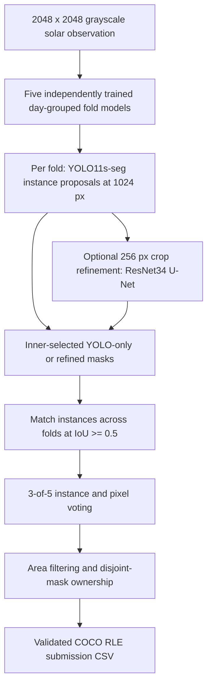

# Table of Contents

Everything in this repository, in one place. Back to the [project page](README.md).

| Jump to | |
| --- | --- |
| [Reports and papers](#reports-and-papers) | Technical report, earlier drafts, results review |
| [Notebooks by version](#notebooks-by-version) | Every notebook, V1 to V13, with its public score |
| [Code and tests](#code-and-tests) | Shared runtimes, helpers and checks |
| [Evidence and analysis](#evidence-and-analysis) | Failure analysis, protocols, saved outputs |
| [Run and reproduce](#run-and-reproduce) | How to run each notebook and rebuild the reports |
| [Technical notes](#technical-notes) | V5 architecture and observations |
| [Document control](#document-control-and-submission) | Submission and judging-form reminders |

## Reports and papers

| Resource | Purpose |
| --- | --- |
| [**Technical report (V4) PDF**](<Research/Academic%20Paper/SolarFilament_V4.pdf>) · [LaTeX source](<Research/Academic%20Paper/SolarFilament_V4.tex>) | Final draft including the verified V7 result and the crop-refinement discussion. |
| [V3 technical report PDF](<Research/Academic%20Paper/SolarFilament_V3.pdf>) · [LaTeX source](<Research/Academic%20Paper/SolarFilament_V3.tex>) | Previous draft; results through V5, preserved. |
| [V2 report PDF](<Research/Academic%20Paper/SolarFilament_V2.pdf>) · [source](<Research/Academic%20Paper/SolarFilament_V2.tex>) | Previous visual report draft, retained for comparison. |
| [First-draft PDF](<Research/Academic%20Paper/SolarFilament.pdf>) · [source](<Research/Academic%20Paper/SolarFilament.tex>) | Historical report, retained for comparison. |
| [Results review](<Research/Academic%20Paper/RESULTS_REVIEW.md>) | Loss histories, labeled V1 metrics, and prediction agreement across four runs. |
| [ESAIR poster](<Research/ESAIRPoster/GRF_Poster_04.2026.pdf>) | Poster version of the project. |
| [60-second baseline review video](<Research/Baseline%20Video/preview-60s.mp4>) | Baseline predictions beside human annotations (qualitative only). |
| [Research notebook](Research/Notes/solar_filament_data_and_research.ipynb) · [CV tutorial](Research/Notes/CV_TUTORIAL.md) | Exploration and educational material. |

## Notebooks by version

Public scores are the Kaggle leaderboard PQ. A dash means the version was not scored or its score was not recorded here.
The [notebooks folder](<Kaggle%20Competition/Notebooks/>) holds the canonical implementations.

| Version | Notebook | What it is | Public PQ |
| --- | --- | --- | ---: |
| **V13** | [**Solar Vision V13 (PyTorch)**](<Kaggle%20Competition/Notebooks/solar_filament_CV_V13_maskrcnn_refiner.ipynb>) | Mask R-CNN ResNet50-FPN V2 + ResNet18 crop U-Net, 4 flipped views, candidate voting. | **0.37** |
| V12 | [V12 notebook](<Kaggle%20Competition/Notebooks/solar_filament_CV_V12.ipynb>) | V11 logic at 10 epochs, more instances, tuned on soft instance Dice. | - |
| **V11** | [**V11 notebook (YOLO)**](<Kaggle%20Competition/Notebooks/solar_filament_CV_V11_crop_refined.ipynb>) · [quick 10-epoch copy](<Kaggle%20Competition/Notebooks/solar_filament_CV_V11_quick10_crop_refined.ipynb>) | YOLO11s-seg + ResNet34 crop refiner, solar-disk filter channels, rotation augmentation, 8-view voting. | **0.37** |
| V10 | [V10 notebook](<Kaggle%20Competition/Notebooks/solar_filament_CV_V10_crop_refined.ipynb>) | `yolo11m-seg` at 1280 px, 100 YOLO and 50 refiner epochs. | - |
| V9 | [V9 notebook](<Kaggle%20Competition/Notebooks/solar_filament_CV_V9_crop_refined.ipynb>) | Same notebook family, up to 40 YOLO and 40 refiner epochs. | - |
| V8 | [V8 notebook](<Kaggle%20Competition/Notebooks/solar_filament_CV_V8_crop_refined.ipynb>) · [V8 runtime](<Kaggle%20Competition/Python%20Files/v8_runtime.py>) | Single YOLO11s-seg + ResNet34 crop refiner with solar-disk normalization. | - |
| V7 | [V7 notebook](<Kaggle%20Competition/Notebooks/solar_filament_CV_V7_yolo_only.ipynb>) | Five-fold YOLO11s-seg, no crop refiner. | 0.26 |
| V6 | [V6 notebook](<Kaggle%20Competition/Notebooks/solar_filament_CV_V6_grouped.ipynb>) | Grouped folds with crop refiner, unscored. | - |
| V5 | [V5 notebook](<Kaggle%20Competition/Notebooks/solar_filament_CV_V5_grouped.ipynb>) · [protocol](<Kaggle%20Competition/reports/V5_FAST_FIVE_FOLD_SUBMISSION.md>) | Five day-grouped YOLO11s-seg / ResNet34 U-Net pairs with 3-of-5 voting. | 0.36 |
| V4 | [V4 notebook](<Kaggle%20Competition/Notebooks/solar_filament_CV_V4.ipynb>) | Intermediate experiment; no reported competition score. | - |
| V3 | [V3 notebook](<Kaggle%20Competition/Notebooks/solar_filament_CV_V3.ipynb>) | Repaired V3: YOLO11s-seg and ResNet18 crop refiner. | 0.35 |
| V2 | [Focused V2 notebook](<Kaggle%20Competition/Notebooks/solar_filament_CV_V2_focused.ipynb>) · [saved evidence](<Kaggle%20Competition/V2Output/results/v2_focused_1024_clahe_from_v1/>) | V1 fine-tuning at 1024 px with CLAHE. | 0.32 |
| V1 | [Baseline notebook](<Kaggle%20Competition/Notebooks/solar-filament-cv.ipynb>) | ResNet18 U-Net baseline at 512 px (the one in the video). | 0.29 |

Public scores are exploratory whole-pipeline comparisons, not controlled evidence that any single change caused a gain.
The V4 academic report is a document version, not the V4 model experiment.

## Code and tests

| Resource | Purpose |
| --- | --- |
| [V13 library](<Kaggle%20Competition/Python%20Files/v13_lib.py>) · [V13 detector training](<Kaggle%20Competition/Python%20Files/v13_train_detector.py>) | Mask R-CNN, refiner, flip voting and scoring behind V13. |
| [V8 to V12 runtime](<Kaggle%20Competition/Python%20Files/v8_runtime.py>) · [solar disk fitting](<Kaggle%20Competition/Python%20Files/solar_disk.py>) | Shared runtime and solar-disk normalization behind the YOLO notebooks. |
| [Shared CV orchestration](<Kaggle%20Competition/Python%20Files/grouped_yolo_cv.py>) · [mask validation](<Kaggle%20Competition/Python%20Files/submission_masks.py>) · [V7 runtime](<Kaggle%20Competition/Python%20Files/v7_yolo_runtime.py>) | Helpers embedded in the standalone notebooks. |
| [Tests](<Kaggle%20Competition/pythontests/>) | Regression checks for the notebooks, runtimes and mask validation. |
| [README figure script](assets/make_readme_assets.py) | Draws the score chart and the architecture diagram. |

The [kaggle-v3](<Kaggle%20Competition/kaggle-v3/>) and [kaggle-v4](<Kaggle%20Competition/kaggle-v4/>) directories are API upload staging.
Additional model dependencies are listed in [Requirements/](Requirements/).

## Evidence and analysis

| Resource | Purpose |
| --- | --- |
| [V1 to V3 mask analysis](<Kaggle%20Competition/reports/V1_V2_V3_MASK_EDA_V4.md>) | Instance proposals, crop refinement and failure analysis. |
| [V5 protocol and audit](<Kaggle%20Competition/reports/V5_FAST_FIVE_FOLD_SUBMISSION.md>) · [accepted V5 CSV](<Kaggle%20Competition/V5_SubmissionFile/submission.csv>) | Best verified five-fold ensemble and submission provenance. |
| [Five-fold YOLO and refiner notes](<Kaggle%20Competition/reports/FIVE_FOLD_YOLO_REFINER.md>) · [V4 changes](<Kaggle%20Competition/reports/V4_CHANGES_AND_NEXT_STEPS.md>) | Design notes behind the fold-based versions. |

## Run and reproduce

Attach the competition dataset to a Kaggle notebook, enable Internet and a GPU,
and review the selected notebook's configuration before running. Download
outputs and inspect their plan, checkpoint hashes, calibration, and submission
audit; a notebook title alone does not establish which model produced a CSV.

**V5:** Follow the [five-fold protocol](<Kaggle%20Competition/reports/V5_FAST_FIVE_FOLD_SUBMISSION.md>).
All five completed folds are required for export. The notebook prepares a
validated CSV but does not automatically upload it.

**V7:** The [YOLO-only notebook](<Kaggle%20Competition/Notebooks/solar_filament_CV_V7_yolo_only.ipynb>) uses
five day-grouped folds, up to 10 epochs per fold, no wall-clock training limit,
and no crop refiner. It targets Kaggle T4x2 with training batch 10 total;
inference uses GPU 0 with batch 8. After five complete folds, it validates and
submits the CSV automatically. Add Kaggle Notebook Secrets named
`KAGGLE_USERNAME` and `KAGGLE_KEY` before running the submission cell. A local
validation pass does not guarantee Kaggle acceptance or a higher score.

**V8:** The [crop-refiner notebook](<Kaggle%20Competition/Notebooks/solar_filament_CV_V8_crop_refined.ipynb>)
trains one YOLO11s-seg detector (20 epochs) and one ResNet34 crop refiner (up to 20
epochs) with no folds or ensemble, on Kaggle T4x2. By default it trains on every labeled
day except about 8% reserved as tuning days (`TRAIN_ON_HOLDOUT = True`), so its scores
are tuning scores; `False` restores a 20% holdout.
Before training, each frame's solar disk is fitted ([solar_disk.py](<Kaggle%20Competition/Python%20Files/solar_disk.py>)):
pixels beyond the rim plus 10 px become neutral gray and the disk is flat-fielded and
z-scored; `DISK_NORMALIZE = False` gives the matched raw baseline. Tuning days choose
the confidence (0.15-0.35) and a `yolo`, `refined`, or `gated` mode, and the holdout is
also scored without refinement. It does not upload: submit the printed CSV manually.

**V9:** the [same notebook](<Kaggle%20Competition/Notebooks/solar_filament_CV_V9_crop_refined.ipynb>) with up to 40 YOLO and 40 refiner epochs,
early stopping after 20 epochs without improvement (both models), and its own run name.

**V10 / V11:** V10 uses `yolo11m-seg` at 1280 px (100 YOLO / 50 refiner epochs). V11 is the same with 30 / 30 epochs plus rotation augmentation after the disk cut: random rotations of up to 180 degrees and up-down flips for YOLO, and random-angle rotations of the refiner's crops (`yolo_augment`, `refiner_rotate`). V11 also feeds both networks three real channels (normalized frame, denoised copy, dark-ridge map; `feature_channels`) and, at test time, lets 8 rotated or flipped views vote on instances and pixels (`tta_views`, `tta_instance_votes`, `tta_pixel_votes`), using voting only if it beats the single view on the tuning photos. The refiner also takes the detector's mask as a fourth input channel (trained on masks simulated from the ground truth) (`refiner_mask_channel`, `refiner_jitter`); an optional second zoom pass (`refiner_zoom`) exists in the code but is off in V11.

**V12:** [V12](<Kaggle%20Competition/Notebooks/solar_filament_CV_V12.ipynb>) is V11 at 10 epochs with a wider confidence grid and voting from 2 of 8 views, tuned on a soft instance Dice (in its printout `pq` holds that soft Dice and `true_pq` the real PQ).

**V13:** a different architecture, rebuilt from the public Mask R-CNN + U-Net refiner notebooks behind the top public leaderboard scores ([notebook](<Kaggle%20Competition/Notebooks/solar_filament_CV_V13_maskrcnn_refiner.ipynb>), code in `Python Files/v13_lib.py` and `v13_train_detector.py`). It trains torchvision Mask R-CNN ResNet50-FPN V2 on whole 1024 px frames (one annotator set per photo, 10 or 15 epochs, two GPUs) and a ResNet18 crop U-Net refiner (10 epochs). At test time 4 flipped views each give up to 10 candidates, the candidates are clustered across views, voted down to a cap of 6-10 instances per photo (the validation photos pick the cap, the minimum number of supporting views and the refiner threshold on soft instance Dice; the table also prints PQ), refined with flipped crops, reduced to the largest piece, and overlapping masks are merged. It needs a GPU session with two T4s; run all cells in the Kaggle editor. It does not upload: submit the printed CSV manually.

**V3 repair:** The original V3 CSV had overlapping masks. The accepted repaired
submission removes overlap without retraining:

```bash
mkdir -p "Kaggle Competition/cv_outputs/v3_repair"
kaggle kernels output gregkoja/solar-filament-cv-v3 -p "Kaggle Competition/cv_outputs/v3_repair"
python "Kaggle Competition/Python Files/submission_masks.py" \
  "Kaggle Competition/cv_outputs/v3_repair/submission.csv" \
  "Kaggle Competition/cv_outputs/v3_repair/submission_disjoint.csv" \
  --test-dir "Kaggle Competition/data/MAGFiLO_1.0_Kaggle_2026/test" --min-area 20
```

The repair writes a separate CSV and audit; submit the repaired file, not the
original. It does not recalibrate the model or upload a submission.

**Rebuild the reports and run checks** from the repository root in an
environment with the plotting and notebook dependencies:

```bash
python -m pip install -r "Research/Academic Paper/requirements-figures.txt"
python "Research/Academic Paper/plot_paper_v2.py"
python "Research/Academic Paper/plot_pipeline_architectures.py"
tectonic -X compile "Research/Academic Paper/SolarFilament_V2.tex" --outdir "Research/Academic Paper"
tectonic -X compile "Research/Academic Paper/SolarFilament_V3.tex" --outdir "Research/Academic Paper"
tectonic -X compile "Research/Academic Paper/SolarFilament_V4.tex" --outdir "Research/Academic Paper"
PYTHONPATH="Kaggle Competition/Python Files" python -m unittest discover -s "Kaggle Competition/pythontests" -p 'test_*.py'
python assets/make_readme_assets.py
```

## Technical notes

### V5 architecture



Each fold trains a detector and refiner; inner tuning selects which output to
use. All five models contribute to fusion, which has no separately trained
parameters. The public score evaluates this complete pipeline, not the
refiner alone.

### Observations

- **Input:** 2048 × 2048 grayscale H-alpha intensity images, not magnetograms.
  The task segments filament instances; it does not infer chirality or magnetic
  polarity.
- **Evaluation:** observation-day grouping keeps photographs and their
  annotator-specific targets together. Inner tuning selects model settings;
  outer holdouts evaluate the selected fold models. Fold metrics are not a
  five-model ensemble score.
- **Instance quality:** YOLO proposes separate objects; optional U-Net
  refinement adjusts local masks. The ensemble matches instances across folds
  and votes on foreground pixels.
- **Submission integrity:** masks are made disjoint and checked for valid RLE,
  dimensions, IDs, CSV readback, and overlaps. The accepted
  [V5 CSV](<Kaggle%20Competition/V5_SubmissionFile/submission.csv>) contains 1,127 masks across
  177 images; its [audit and provenance](<Kaggle%20Competition/reports/V5_FAST_FIVE_FOLD_SUBMISSION.md>)
  describe the three images without retained predictions.
- **Limitations:** the labeled data have been used during development, public
  scores are not causal ablations, and final weights, calibration, logs, and
  pinned environments still need to be published for complete reproduction.

## Document control and submission

The current [V4 report](<Research/Academic%20Paper/SolarFilament_V4.pdf>) is the final
draft including verified V7 submission 58336694 (0.26 PQ). Earlier paper drafts
are retained. Preserve the reviewed PDF, repository revision, submission IDs,
scores, and supporting artifacts. Local edits are not public until committed
and pushed.

The competition prediction submission does not replace the organizers' judging
form and report upload. Check the form's current requirements and deadline.

Keep credentials in Kaggle Secrets or another secure credential store, never
embed them in notebooks. Obtain competition data through Kaggle. The
[MIT license](LICENSE) covers original project code; third-party datasets,
templates, software, and pretrained weights retain their own terms.
