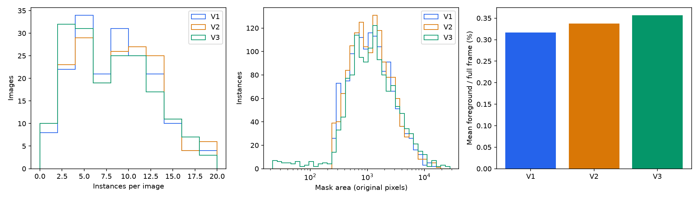
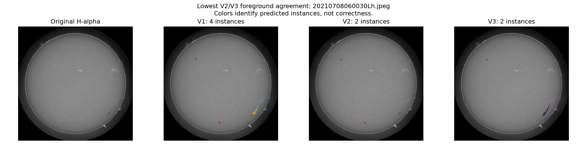
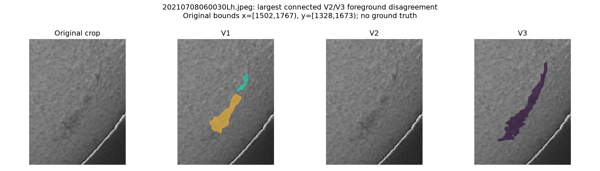
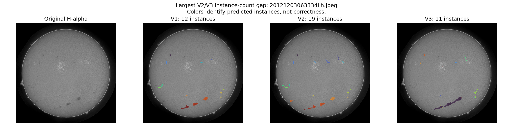
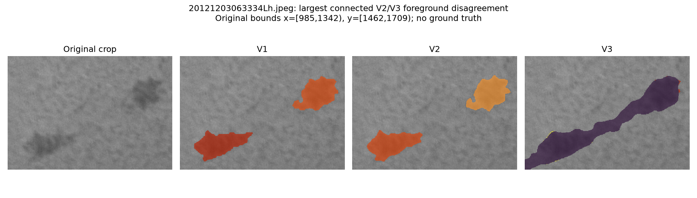
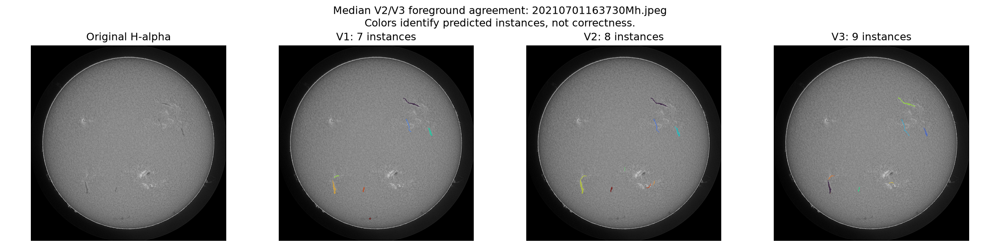
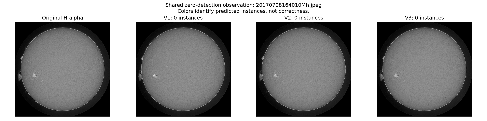
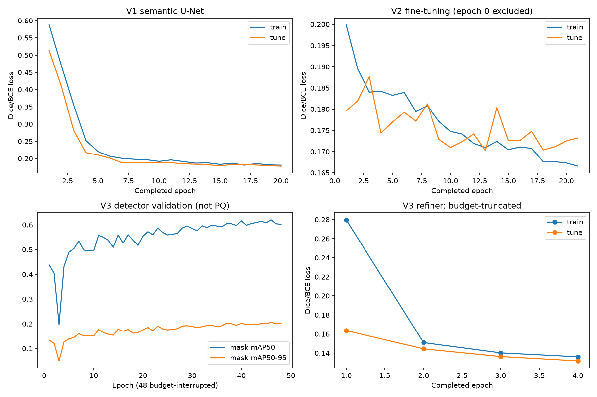

# From V1 to V3: mask EDA and an evidence-based V4

## Executive summary

**Verified public leaderboard PQ: V1 = 0.29, focused V2 = 0.32, repaired V3 = 0.35.**
The V3 score belongs to the offline disjoint-mask repair, not its rejected
overlapping-mask submission or an unrun recalibrated variant.

This report measures the actual saved predictions for **all 180 physical test
images**, not a sample. It also examines saved training histories. It does not
train, upload, or submit anything.

The strongest evidence for longer V4 training is the **crop refiner**:
validation loss improved at every completed epoch before its budget expired.
The detector improved over its run, but its final validation results fluctuated
near a plateau. Removing the time limits creates an opportunity to improve;
it does not guarantee a higher leaderboard score.

Key observations:

- V3 has **fewer masks but more foreground pixels** than V2.
- **253 of 1,370 V3 instances (18.5%) are disconnected** under 8-connectivity.
  V1/V2 have none, in part because their instances are constructed as connected
  components. This difference is not, by itself, evidence that V3 is wrong.
- All three runs omit the **same three test images**. No architecture has yet
  eliminated this shared zero-detection behavior.
- Longer training will not automatically fix instance duplication, wrong pixel
  ownership, or a mismatch between ground-truth training crops and detector crops.

## 1. What changed between the models?

| Property | V1 | Focused V2 | Submitted V3 |
|---|---|---|---|
| Main network | ResNet18 U-Net | Same semantic U-Net, fine-tuned from V1 | YOLO11s-seg plus ResNet18 U-Net crop refiner |
| Full-frame model input | 512 pixels | 1024 pixels + CLAHE | 1024 pixels; no CLAHE |
| Local refinement | None | None | 256-pixel context crops |
| Meaning of a mask | Connected region of thresholded foreground | Same, with changed preprocessing/training | Individual detector proposal, optionally refined |
| Instance separation | Connected components after semantic prediction | Connected components | Learned proposals, then disjoint pixel ownership |
| Small-area cutoff | Calibrated; submitted masks all at least 256 pixels | Selected cutoff 256 pixels | Selected cutoff 20 pixels, also applied after repair |
| Training evidence | 20 epochs | 21 additional epochs; best at 13 | Detector budget stop; only 4 complete refiner epochs |
| Public PQ | 0.29 | 0.32 | 0.35 |
| Completed submission | 58301531 | 58304132 | 58316663 |

These are exploratory runs, not a controlled architecture ablation. Resolution,
preprocessing, training, postprocessing, and supervision interfaces changed.
The separate grouped-fold V2 notebook is **not** the scored focused V2 run.

### Semantic masks versus instance masks

V1/V2 first estimate a single foreground probability:

$$p(x,y)=P(\text{filament foreground at }(x,y)).$$

Thresholding makes a binary foreground image; connected components become
instance masks. A one-pixel bridge can merge two filaments, while a gap can
split one into several predictions.

YOLO predicts separate objects and associated masks. The crop refiner estimates
foreground within each proposed crop, then maps it back to the original
2048-by-2048 frame. Because the refiner sees the crop image without a proposal
mask channel, it may include neighboring structures rather than exclusively
the intended filament.

### Why disjoint masks matter

Kaggle rejected original V3 submission 58315901 for overlapping masks.
Its 1,417 instance rows contained overlaps in 99 images. The repaired submission
keeps prediction order, assigns shared pixels to the earliest retained mask,
and removes empty or below-20-pixel remnants. It contains **1,370 rows**;
47 original rows were removed. All retained foreground pixels came from the
original predictions. The original source CSV remains unchanged.

The original CSV had **328,648 unique pixels** belonging to multiple masks.
The repair audit records **338,575 pixel claims removed from retained-priority
ownership conflicts**; this is a different quantity, because more than two
masks can claim the same pixel. These counts must not be conflated.

This repair ensures validity, not optimal ownership. Original tuning scores
were measured before repair and are not estimates of repaired-mask PQ.
The updated [V3 notebook](../solar_filament_CV_V3.ipynb) applies disjoint
postprocessing during both calibration and export and rejects stale calibration.

## 2. Quantitative EDA of the submitted masks

All area measurements below use original-resolution pixels. Foreground coverage
is divided by the **whole frame**, including off-disk background, not solar-disk
area. Each run has zero overlapping pixels after validation.

| Measurement across 180 test images | V1 | Focused V2 | Repaired V3 |
|---|---:|---:|---:|
| Predicted instances | 1,421 | 1,470 | 1,370 |
| Mean instances per image, including zeros | 7.89 | 8.17 | 7.61 |
| Images with no predictions | 3 | 3 | 3 |
| Total foreground pixels | 2,392,239 | 2,547,244 | 2,694,933 |
| Mean full-frame foreground coverage | 0.3169% | 0.3374% | 0.3570% |
| Instance area, 10th percentile | 386 | 414.9 | 392.9 |
| Instance area, median | 1,111 | 1,144 | 1,183 |
| Instance area, 90th percentile | 3,583 | 3,634.2 | 4,290.9 |
| Instances smaller than 256 pixels | 0 | 0 | 64 |
| Instances with multiple 8-connected regions | 0 | 0 | 253 |
| Median mask area / bounding-box area | 0.332 | 0.311 | 0.237 |



### Interpretation, without claiming unseen accuracy

**Fewer masks, more area:** compared with V2, V3 predicts 100 fewer instances
but 147,689 more foreground pixels. Its upper area quantile is larger.
Possible explanations include recovering longer structures, merging neighbors,
or predicting wider masks. Only labeled validation can distinguish these.
The public PQ improvement does not identify which explanation dominates.

**Disconnected masks:** the V3 masks with multiple components include examples
with as many as 90 components. Small islands could reflect crop probabilities,
resizing, or overlap trimming; this report cannot attribute their cause from
the final CSV alone. A fragmented mask can also legitimately describe a
partially visible structure. Do not automatically split every component into
a new filament or discard every component except the largest.

**Smaller bounding-box fill:** V3's lower median fill can describe slender,
curved filaments, disconnected islands, or extraneous foreground. It is not a
standalone quality metric.

**Small masks:** V3 permits 20-pixel instances while V1/V2 used larger area
filters. Its 64 masks below 256 pixels may include real small filaments or
false positives. The counts are confounded by different postprocessing rules.

**Shared zero detections:** all runs omit:

- `20170708164010Mh.jpeg`
- `20200310113230Ch.jpeg`
- `20211214174010Mh.jpeg`

Inspect image quality and corresponding *labeled validation analogues* before
changing thresholds. A zero-detection test image is not automatically a missed
filament; there may be no annotated target. Never fabricate masks to fill rows.

## 3. Agreement is not ground-truth accuracy

For each image and pair of runs, this analysis computes:

1. **Foreground union IoU:** overlap of all foreground pixels, ignoring instances.
2. **Instance agreement:** maximum-cardinality one-to-one matching of predicted
   instances with IoU strictly greater than 0.5:

$$A_{\rm instance}=\frac{2M}{N_a+N_b}.$$

Neither run is ground truth. This is **not PQ**, precision, recall, or ensemble
performance. Images empty in both runs are excluded from these means rather
than counted as perfect agreement; all pairs have 177 nonempty comparisons.

| Pair | Mean foreground union IoU | Mean instance agreement |
|---|---:|---:|
| V1 vs V2 | 0.712 | 0.796 |
| V2 vs V3 | 0.653 | 0.699 |
| V1 vs V3 | 0.628 | 0.664 |

V1/V2 are more similar to each other than either is to V3. V3 is changing
both selected foreground and object grouping. Disagreement suggests useful
examples to inspect, **not an automatic benefit from ensembling**. Directly
concatenating masks from several runs would reintroduce overlaps and duplicates.

## 4. Image comparisons

Colors distinguish instances **within each panel**. They are not consistent
cross-run identities, confidence, or correctness. Selection is deterministic:
the most divergent and median V2/V3 foreground cases, largest count gap, and
one shared empty observation. This is an illustrative selection, not an
unbiased visual estimate of accuracy. Numerical summaries use all images.

### A. Lowest V2/V3 foreground agreement

`20210708060030Lh.jpeg`: V1 predicts 4 instances, V2 2, and V3 2.
Equal counts do not imply the same structures: V2 has 957 foreground pixels
versus V3's 5,964. The lower-right structure differs substantially.




**V4 question:** on labeled analogues, is the limb-adjacent structure a recovered
filament or contamination? More pixels alone cannot answer this.

### B. Largest V2/V3 instance-count gap

`20121203063334Lh.jpeg`: V1 predicts 12 instances, V2 19, and V3 11.
The lower elongated structure is represented differently: V2 shows several
separate predicted regions, whereas V3 assigns a much larger elongated region
to one prediction. This could reduce semantic fragmentation, but it could also
merge annotated objects. Test labels are unavailable.




**V4 question:** use pairwise IoU matching against validation instances to
distinguish correct joining from incorrect merging.

### C. Median foreground agreement, not a selected success case

`20210701163730Mh.jpeg`: instance counts are 7 / 8 / 9 for V1 / V2 / V3.
Foreground pixel totals are 8,325 / 9,822 / 8,129.



### D. Shared zero-detection observation

`20170708164010Mh.jpeg`: all three exports contain no predictions.



## 5. Convergence evidence: what longer training can address



### V1: improvement continued, but slowly

The lowest recorded tuning loss was **0.178067 at epoch 20**, the last epoch.
This supports testing a longer schedule, but the improvement late in training
was small. Loss and instance PQ are not interchangeable.

### V2: more epochs were not automatically better

V2 completed 21 additional epochs and selected **additional epoch 13** with
tuning loss **0.170214**. Training loss subsequently continued falling while
tuning loss fluctuated above its minimum. Early stopping, rather than a time
cutoff, ended this run. This is evidence against assuming that every longer
training run produces a better generalizing checkpoint.

### V3 detector: a budget stop, with flattening late metrics

The trainer reports 48 epochs and a 1.254-hour run, but the progress log is more
specific: **47 full training epochs plus epoch 48 interrupted at 18/207 batches**.
The final partial epoch was validated; it must not be described as a full
additional pass through the training data.

Validation mask mAP50 / mAP50-95:

- Epoch 1: **0.438 / 0.134**
- Epoch 37: **0.605 / 0.203**
- Epoch 46: **0.620 / 0.206** (highest observed values for both)
- Epoch 47: **0.604 / 0.200**
- Partial epoch 48: **0.602 / 0.201**

The detector clearly learned, but late gains were smaller and noisy.
Continuing is a reasonable experiment, not evidence that another 50 epochs
will deliver a large jump. These metrics are not competition PQ.

### V3 refiner: strongest case for more training

| Completed refiner epoch | Training loss | Tuning loss |
|---|---:|---:|
| 1 | 0.279706 | 0.163618 |
| 2 | 0.151050 | 0.144484 |
| 3 | 0.140253 | 0.136369 |
| 4 | 0.136127 | 0.131818 |

Tuning loss fell approximately **19.4%** from epoch 1 to 4, improving each time.
The runtime records `budget_truncated`, not convergence or early stopping.
The interrupted next epoch was discarded by the training loop.
This provides stronger support for removing the refiner budget than for
assuming the detector needs unlimited training. Crop loss still does not
guarantee improved full-frame instance PQ.

## 6. V4: longer training with measurable safeguards

### First V4 run: isolate training duration as much as possible

1. Retain the fixed day-grouped split, architecture, resolution, annotations,
   augmentation, and disjoint policy.
2. Remove both training wall-time cutoffs; use explicit epoch ceilings and
   early stopping. An initial experimental ceiling could be **120 detector
   epochs and 40 refiner epochs**, with detector patience 15 and refiner
   patience 8. These are starting hypotheses, not optimized settings.
3. Keep the best checkpoints, not simply the final epoch.
4. Calibrate YOLO-only and refined modes using **disjoint** masks on the same
   tuning images. Initially retain the same 32-image subset and threshold grid
   to avoid also changing calibration in the duration comparison.
5. To isolate the training effect fairly, recalibrate the original V3 weights
   under that exact policy too. The offline-repaired 0.35 output remains the
   historical leaderboard baseline, not a perfectly controlled comparator.
6. Report duration, completed epochs, stopping reason, mask counts, validation
   PQ, TP/FP/FN, and YOLO-only versus refined results before submitting.

**Implementation follow-up:** the [V4 notebook](../solar_filament_CV_V4.ipynb)
now implements the longer ceilings and optional deadlines, with explicit
AdamW settings matching V3. In the existing V3 code, `yolo_hours` is passed to the
Ultralytics `time` argument; epoch-limited training should use `time=None`.
The custom refiner currently computes
`deadline = time.monotonic() + V3["refiner_hours"] * 3600`.
Setting `refiner_hours=None` alone will fail: V4 must conditionally omit that
deadline and its comparison. Do not use zero hours, which would stop immediately.
Do not pass nonfinite hours into JSON-backed settings.

Use a **new run name** for changed training settings; do not overwrite V3.
The current loaders require identical saved settings and do not implement
optimizer-state resume. Merely changing the hours and disabling training will
fail provenance checks; genuine continuation needs an explicit, recorded
parent-checkpoint loading path. Increasing the epoch ceiling also changes
the refiner's cosine learning-rate schedule, so it is not identical to simply
continuing an otherwise unchanged optimization trajectory.

Kaggle platform/session limits still apply even after our own cutoffs are
removed. Save progress and checkpoints accordingly. V4 is a separately
authorized training experiment, not a result of this EDA; its score is unknown.

### Subsequent controlled experiments

| Measured problem on labeled validation | Candidate change | What must improve |
|---|---|---|
| Refiner includes neighbors or wrong fragments | Jitter crop position/scale; later test a detector-mask input channel | Full-frame disjoint PQ, not just crop loss |
| Duplicated or contested instances | Confidence/probability-aware ownership and duplicate suppression | Fewer FP without losing matched instances |
| Small spurious islands | Test component-area cleanup while retaining instance identity | PQ; avoid deleting valid thin branches |
| Missed faint/small instances | Confidence calibration, then higher-resolution inference/training | Recall at acceptable FP cost |
| Boundary mismatch on detected objects | Refiner threshold, crop resolution, training schedule | Matched-instance IoU and PQ |
| Unstable calibration selection | Expand to all tuning images after duration comparison | Stable parameter ranking, not public-score chasing |

Do not split all 253 disconnected masks automatically: that may create extra
instances and increase the PQ false-positive penalty. Do not merge every
neighboring region either. Use labeled tuning examples and instance matching.

Training crops currently use true instance bounds, whereas inference uses
detector-derived bounds. Longer training does not remove that domain mismatch.
Adding a coarse mask input would change the architecture and needs its own
experiment, not an unacknowledged extra change in the duration baseline.

## 7. Metric and evaluation boundaries

$$PQ=\frac{\sum_{(p,g)\in TP} IoU(p,g)}
{|TP|+\tfrac12|FP|+\tfrac12|FN|}.$$

The local implementation matches instances at IoU strictly greater than 0.5.
Correct object separation and boundary overlap both matter; millions of easy
background pixels do not compensate for extra or missed objects.

- No test ground truth was available. No per-image test PQ, Dice accuracy,
  precision, or recall is claimed here.
- This test-output EDA is descriptive. Select hyperparameters using labeled
  tuning data, not whichever changes make these selected examples look nicer.
- The public leaderboard is an external measurement, not a substitute for
  validation. Repeated public-score selection can overfit that feedback.
- Use a separate held-out assessment for the chosen configuration, explicitly
  acknowledging that the project's V1 holdout has already been inspected.
- No score target or convergence guarantee is justified by these three runs.

## 8. Reproduce and inspect the evidence

From the repository root, using an environment with the existing
[V3 requirements](../requirements-v3.txt):

```bash
python compare_run_masks.py
python -m unittest discover -s tests -p 'test_*masks.py'
```

The analysis requires local competition test JPEGs and downloaded outputs at:

- `cv_outputs/kaggle_baseline_v1/submission.csv`
- `V2Output/results/submission.csv`
- `cv_outputs/kaggle_v3/submission_disjoint.csv`
- V1/V2 training histories and the V3 saved log at the paths used in
  [the analysis script](../compare_run_masks.py).

No datasets, model weights, or Kaggle credentials are embedded in this report.
The illustrations are derived from competition images and retain the dataset's
terms; repository licensing does not relicense those images.

Machine-readable evidence:

- [Summary, source SHA-256 hashes, and parsed training history](v1-v3-assets/summary.json)
- [All 540 run/image measurements](v1-v3-assets/per_image.csv)
- [All 4,261 instance measurements](v1-v3-assets/per_instance.csv)
- [All 540 pair/image agreement measurements](v1-v3-assets/agreement.csv)

The source hash for the scored repaired V3 CSV is
`425b6fff45a20ca44fc99b179fa6d8a4bd6779fbd0b582e69a7afd995dfbc042`.
Source CSVs are read-only to this analysis. Generated figures and measurements
are deterministic for those inputs; they do not represent a new model run.
